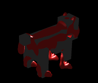
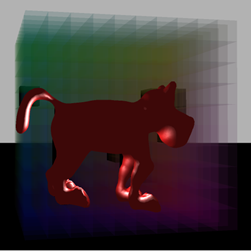
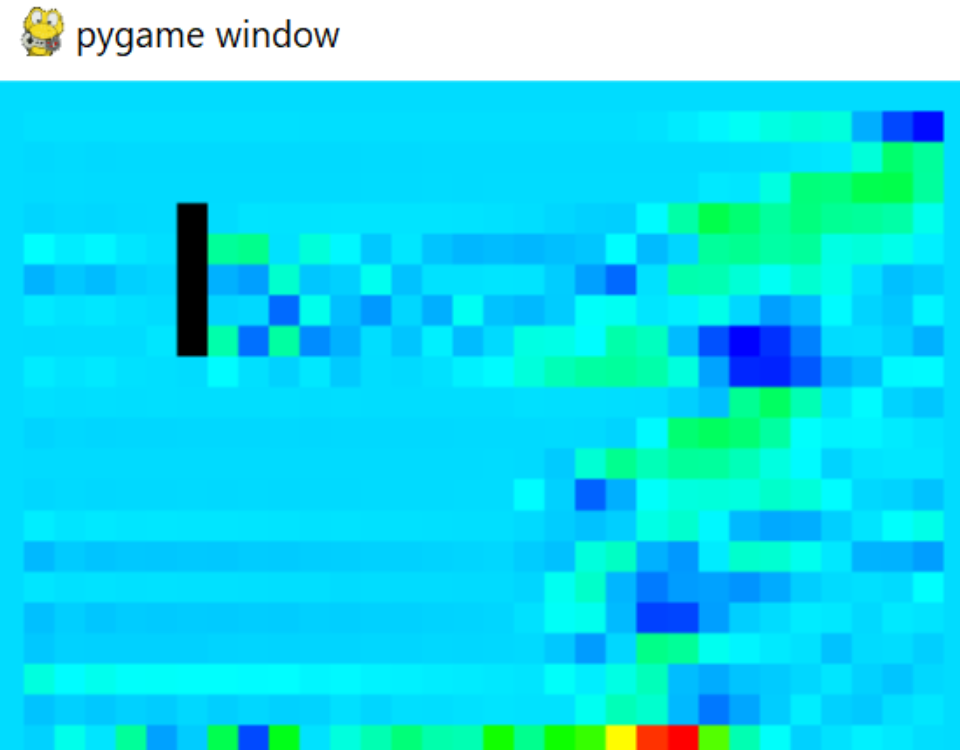
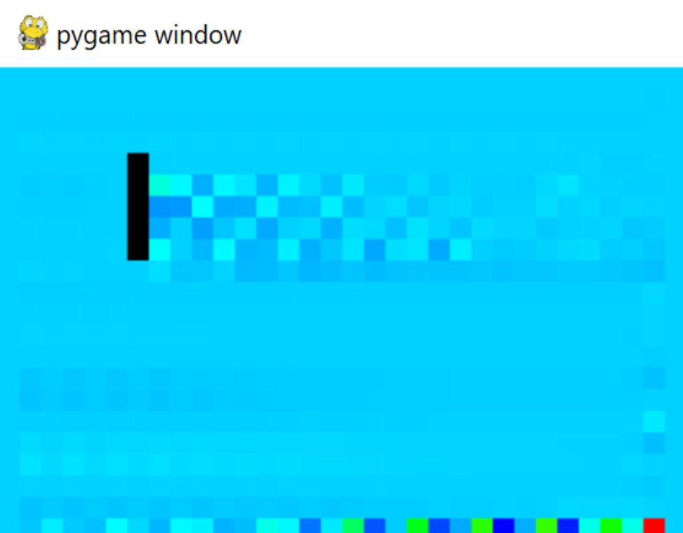

<body>
	

	<header>
		<h3><u>Physical Systems of Atmospheric Entry - A Simulation</u></h3>
		<h4>Zachary Wayne, Samuel Shard</h4>
		
Ontario Tech University

		
CSCI 3010U - Simulation and Modeling

		
Prof. Faisal Qureshi

		
April 6, 2024

	</header>
	

</body>

# Abstract
The Physical Systems of Atmospheric Entry simulation project aims to provide an understanding of the complex dynamics of atmospheric entry for various three-dimensional objects and, thus, an understanding of simulating fluid. This project simulates any .OBJ object through any defined atmosphere. For example, this project simulated a space capsule re-entering an Earth-like atmosphere or even a football entering a Venus-like atmosphere. By simulating fluid dynamics, environmental factors, and physical object interactions, this project assists in visualizing and experimenting with different variables related to atmospheric entry.

# Introduction
The Physical Systems of Atmospheric Entry simulation project develops a three-dimensional fluid simulation model. It accurately represents air as a fluid medium during atmospheric entry and tests environmental variables such as air density and pressure gradients for simulation realism. Eulerian fluid simulation, Navier-Stokes equations, and advection simulation techniques, including semi-Lagrangian schemes, are applied. Forces are simulated on three-dimensional rigid bodies from model files within the simulated atmospheric entry environment. This simulation includes appealing graphics and visualizations representing the models, atmospheres, and aerodynamic heating effects from drag.

# Objectives and Scope
The Physical Systems of Atmospheric Entry simulation project aims to develop a comprehensive three-dimensional fluid simulation model. This model will accurately depict air as a fluid medium during atmospheric entry, incorporating environmental variables like air density, friction, and pressure gradients for realism. The project will use Eulerian fluid simulation, Navier-Stokes equations, and advection simulation techniques such as semi-Lagrangian schemes to simulate the behaviour of various three-dimensional objects, including space capsules and footballs, across different atmospheres. Forces acting on rigid bodies will be simulated within the atmospheric entry environment, featuring visually appealing graphics and representations of aerodynamic heating effects.

# Methodology
## Fluid Simulation  
### Eulerian Cell Model
In a cell-based fluid simulator, air can be simulated by evenly dividing the space into a grid of cells, each representing a small volume of air. The simulation computes how air flows through these cells based on physical principles such as conservation of mass and momentum. Within each cell, properties such as density, velocity, and pressure are calculated to determine how the air moves and interacts with neighbouring cells. By simulating the transfer of these properties between adjacent cells over time, the behaviour of air, including phenomena like turbulence and diffusion, can be realistically replicated. 

In this cell-based Eulerian fluid simulation model, the Eulerian approach is applied to each cell within the grid. Each cell serves as a fixed point in space where the properties of the fluid are observed over time. The behaviour of the entire fluid domain can be simulated by computing the changes in these properties within each cell and their interactions with adjacent cells (via Navier-Stokes equations and advection).

### Navier-Stokes Equations and Incompressibility
The Navier-Stokes equations, formulated by the theories of Claude-Louis Navier (1822) and George Gabriel Stokes (1842-50) and derived from fundamental physical laws, serve as a foundational framework for understanding fluid motion. These equations encompass viscosity, pressure gradients, and external forces acting on the fluid. The Navier-Stokes equations are vital for this simulation project and are widely used in engineering, meteorology, and fluid dynamics simulations.

The Navier-Stokes equations are generalized and expressed as the following:
$$\frac{\partial \mathbf{u}}{\partial t} + (\mathbf{u} \cdot \nabla) \mathbf{u} = -\frac{1}{\rho} \nabla p + \nu \nabla^2 \mathbf{u} + \mathbf{f}$$
Where:
- $\mathbf{u}$ is the velocity vector field
- $\nabla$ is the del (gradient) operator, so $\nabla p$ is the pressure gradient and $\nabla^2$ is the Laplacian
- $t$ is time
- $\rho$ is fluid density
- $p$ is pressure
- $\nu$ is the kinematic viscosity
- $\mathbf{f}$ represents any external forces acting on the fluid

The Navier Stokes Equations can be broken down into the following terms:
- The change in velocity of the fluid over time $t$.
$$\frac{\partial \mathbf{u}}{\partial t}$$
- The velocity gradient, or convection value, used for representing the momentum of the fluid.
$$(\mathbf{u} \cdot \nabla) \mathbf{u}$$
- The pressure gradient; this dictates the acceleration/deceleration of fluids between areas of varying pressures.
$$-\frac{1}{\rho} \nabla p$$
- The viscosity of the fluid; it equalizes velocities and dampens fluid momentum.
$$\nu \nabla^2 \mathbf{u}$$

In three dimensions the velocity has three components, $\mathbf{u} = (u, v, w)$, and the equation is solved once per component.
Furthermore, implementing the Navier-Stokes equations involves assessing how the fluid's velocity changes at each point in the grid space. This assessment, known as evaluating the divergence of the velocity field, helps determine the pressure gradients within the fluid. By adjusting the velocities based on these pressure gradients, the simulation ensures that the fluid remains incompressible, mimicking the natural behaviour of fluids. Additionally, the momentum equations dictate the evolution of each velocity component $u$, $v$ and $w$, considering terms such as advection, pressure gradients, viscous diffusion, and external forces. Written per component, they are:

$$\frac{\partial u}{\partial t} + (\mathbf{u} \cdot \nabla) u = -\frac{1}{\rho}\frac{\partial p}{\partial x} + \nu \nabla^2 u + f_x$$
$$\frac{\partial v}{\partial t} + (\mathbf{u} \cdot \nabla) v = -\frac{1}{\rho}\frac{\partial p}{\partial y} + \nu \nabla^2 v + f_y$$
$$\frac{\partial w}{\partial t} + (\mathbf{u} \cdot \nabla) w = -\frac{1}{\rho}\frac{\partial p}{\partial z} + \nu \nabla^2 w + f_z$$

The incompressibility condition the pressure solve enforces is that the velocity field has zero divergence:

$$\nabla \cdot \mathbf{u} = \frac{\partial u}{\partial x} + \frac{\partial v}{\partial y} + \frac{\partial w}{\partial z} = 0$$
### Advection Simulation

In fluid simulation, advection refers to the transport of fluid properties (such as density, temperature, or velocity) by the bulk motion of the fluid. Advection plays an important role in simulating the movement of substances within a fluid medium, such as smoke or ablative material being blown away. In this simulation, it will be utilized to visualize aerodynamic heating and flames of ionized gas.

One common approach to simulating advection is through semi-Lagrangian schemes. Semi-Lagrangian schemes are numerical techniques used to solve advection equations by tracing the movement of particles or fluid elements backward in time. This approach offers several advantages, including stability and computation efficiency, mainly when dealing with large-scale fluid simulations. Semi-Lagrangian methods are preferred over a complete Lagrangian scheme in this context, as the fluid simulation uses a cell-based approach, allowing for both the static properties of the fluid cells and the moving properties of ionized flames to be used together in one model.

## Simulation Environment
### Air Density with the Barometric Formula
The formula for air density $\rho$ at a given altitude $h$ can be derived from the barometric formula:
$$\rho(h) = \frac{{P(h) \cdot M}}{{R \cdot T(h)}}$$
Where:
- $\rho(h)$ is the air density at altitude $h$ ($\text{kg/m}^3$).
- $M$ is the molar mass of air ($\text{kg/mol}$).
- $R$ is the universal gas constant ($\text{J/(mol·K)}$).
- $T(h)$ is the temperature at altitude $h$ ($\text{K}$).
- $P(h)$ is the pressure at altitude $h$ ($\text{Pa}$).

The temperature at altitude $h$ can be calculated with the following equation:
$$T(h) = T_0 - L \cdot h$$
Where:
- $T_0$ is the temperature at sea level (surface temperature) ($\text{K}$).
- $L$ is the temperature lapse rate ($\text{K/m}$).

In order to solve for $P(h)$, the pressure at height $h$, the following equation is used:
$$P(h) = P_0 \cdot \left(1 - \frac{{L \cdot h}}{{T_0}}\right)^{\frac{{g \cdot M}}{{R \cdot L}}}$$
Where:
- $P_0$ is the pressure at the surface ($\text{Pa}$).
- $g$ is the acceleration due to gravity ($\text{m/s}^2$).

These equations are then put together to form the following equation, which allows for entry of custom values to find air density at any height $h$ above the planet’s surface:

$$\rho(h) = \frac{{P_0 \cdot \left(1 - \frac{{L \cdot h}}{{T_0}}\right)^{\frac{{g \cdot M}}{{R \cdot L}}} \cdot M}}{{R \cdot (T_0 - L \cdot h)}}$$

The distance between the simulated object and the surface of the planet are passed in as $h$, and the density value returned will be passed along to the fluid simulator's environmental variables, along with the inverse of the object's velocity vectors to control fluid speed and direction.

## The Rigid Body
### Mesh to Cell Interface
The 3D model was loaded into OpenGL using the tinyobjloader library.  The object's scale was determined by iterating through all vertices in the 3D model and determining the maximum and minimum x, y and z values.  Finally, the largest dimension of the model was scaled to have a length of one.  Then, a ten by ten by ten grid of semi-transparent cubes was rendered around the 3D model to represent the voxel grid.  The side length of each cube was 0.1, so the overall voxel grid would also have a dimension of 1 in all dimensions.  This ensures that the 3D model is precisely covered by the voxel grid.

The Moller-Trumbore collision algorithm was used to determine which voxels were filled by the 3D model.  First, the algorithm determines two edges on the triangle by subtracting vertex 1 by vertex 0 and vertex 2 by vertex 0, respectively.  The cross product of the ray vector and edge 2 are taken.  If the dot product between edge 1 and this cross product is 0, then the ray is parallel to the triangle, and there is no intersection.  This algorithm determines whether a ray shot from a given point intersects with a face.  A ray was shot from the center of each voxel, and this test was performed for every triangular face in the model.  The number of times the ray intersected with the 3D model determined whether the point was inside or outside the 3D model.  The point is inside the model if the intersection count is odd.  This was used to approximate if each voxel was filled by the grid.  As shown in Figure 1, the solid voxels are coloured black.  As shown in Figure 2, the simulation controlled the colour of the remaining voxels to visualize the voxel's pressure.

Figure 1

Figure 2

# Simulation Results
The simulation was performed in Python, and the following results were achieved.  A 2D mesh of 30 by 20 voxels was used, and a predefined line of voxels was set to be solid.  The solid line is black, and the other voxels change colour based on their current pressure, which simulates wind.  Figure 3 shows the simulation shortly after it started running, and Figure 4 shows it after a few minutes have passed.  The simulation code was modified to run in C++ using OpenGL.  As explained in the previous section, a 3D mesh was loaded into a grid of voxels, and the voxelization function was used to determine which squares were solid.  The simulation should be run in the same manner in a future version of the project.

Figure 3: Initial Simulation in Python

Figure 4: Python Simulation Over Time, with high velocity, low viscocity fluid moving from left to right

# Conclusion
In conclusion, Navier-Stokes equations were used to simulate the pressure of a fluid in a wind tunnel.  The theory of calculating the air density at a given height above a planet was discussed, and how it could be added to future simulation versions was explained.  Limitations include that the current working Python version of the simulation does not allow the viewer to rotate the camera in 3D, so the result looks similar to 2D.  A free-camera system was created to load a 3D object in OpenGL, and the fluid equations would need to be converted into C.

# References

A. Staniforth and J. Côté, “Semi-Lagrangian Methods,” Sep. 1991.
[https://www.ecmwf.int/sites/default/files/elibrary/1998/12384-semi-lagrangian-methods.pdf](https://www.ecmwf.int/sites/default/files/elibrary/1998/12384-semi-lagrangian-methods.pdf)

C. Tansley and D. Marshall, “Flow past a Cylinder on a β Plane, with Application to Gulf Stream Separation and the Antarctic Circumpolar Current,” Journal of Physical Oceanography, May 2000.
[https://wayback.archive-it.org/all/20110401142411/http://www.met.reading.ac.uk/~ocean/Dynamics/pub/tm01b.pdf](https://wayback.archive-it.org/all/20110401142411/http://www.met.reading.ac.uk/~ocean/Dynamics/pub/tm01b.pdf)

Dimev, “Dimev/Realistic-Atmosphere-Godot-and-UE4,” GitHub, Mar. 29, 2024.
[https://github.com/Dimev/Realistic-Atmosphere-Godot-and-UE4?tab=readme-ov-file](https://github.com/Dimev/Realistic-Atmosphere-Godot-and-UE4?tab=readme-ov-file)

F. M. Miró , E. S. Beyak, D. Mullen, F. Pinna, and H. L. Reed, “Ionization and Dissociation Effects on Hypersonic Boundary-Layer Stability,” Sep. 14, 2018.
[https://www.icas.org/ICAS_ARCHIVE/ICAS2018/data/papers/ICAS2018_0837_paper.pdf](https://www.icas.org/ICAS_ARCHIVE/ICAS2018/data/papers/ICAS2018_0837_paper.pdf)

H. Jiang, J. Liu, S. Luo, W. Huang, J. Wang, and M. Liu, “Thermochemical non-equilibrium Effects on Hypersonic Shock wave/turbulent boundary-layer Interaction,” Sep. 2021.
[https://www.sciencedirect.com/science/article/abs/pii/S0094576521006457](https://www.sciencedirect.com/science/article/abs/pii/S0094576521006457)

K. Goodall and NASA, “English - University of Indianapolis,” www.uindy.edu, Jun. 09, 2000.
[https://web.archive.org/web/20040821230232/http://english.uindy.edu/dynes/red_mars/aerobraking2.pdf](https://web.archive.org/web/20040821230232/http://english.uindy.edu/dynes/red_mars/aerobraking2.pdf)

KirillP,. “Default Cube Free low-poly 3D model.” CGTrader - 3D Models for VR / AR and CG projects, Jul. 08, 2022.
[https://www.cgtrader.com/free-3d-models/various/various-models/default-cube-fd46b883-71f4-443f-877d-3669dc0ad9ce](https://www.cgtrader.com/free-3d-models/various/various-models/default-cube-fd46b883-71f4-443f-877d-3669dc0ad9ce)

M. Müller, “How to write an Eulerian Fluid Simulator,” matthias-research.github.io, Dec. 03, 2022.
[https://matthias-research.github.io/pages/tenMinutePhysics/17-fluidSim.pdf](https://matthias-research.github.io/pages/tenMinutePhysics/17-fluidSim.pdf)

N. Foster and D. Metaxas, “Realistic Animation of Liquids,” Jun. 1996.
[https://www.cbim.rutgers.edu/dmdocuments/gmip96%20Foster.pdf](https://www.cbim.rutgers.edu/dmdocuments/gmip96%20Foster.pdf)

NASA, “Earth Atmosphere Model - Metric Units,” nasa.gov, 2014.
[https://www.grc.nasa.gov/WWW/BGH/atmosmet.html](https://www.grc.nasa.gov/WWW/BGH/atmosmet.html)

NASA, “Orion Reference Guide,” Feb. 2023.
[https://www.nasa.gov/wp-content/uploads/2023/02/orion-reference-guide-111022.pdf](https://www.nasa.gov/wp-content/uploads/2023/02/orion-reference-guide-111022.pdf)

NASA, “Speed Regimes - Hypersonic Re-Entry,” nasa.gov, 2014.
[https://www.grc.nasa.gov/WWW/BGH/hihyper.html](https://www.grc.nasa.gov/WWW/BGH/hihyper.html)

NVIDIA, “The Basics of GPU Voxelization,” NVIDIA Developer, 2023.
[https://developer.nvidia.com/content/basics-gpu-voxelization](https://developer.nvidia.com/content/basics-gpu-voxelization)

R. Shelquist, “Equations - Air Density and Density Altitude,” wahiduddin.net, Jan. 21, 2023.
[https://wahiduddin.net/calc/density_altitude.htm](https://wahiduddin.net/calc/density_altitude.htm)

Royal Meteorological Society, “Lapse Rate,” SKYbrary Aviation Safety, Jun. 18, 2021.
[https://skybrary.aero/articles/lapse-rate](https://skybrary.aero/articles/lapse-rate)

T. Möller and B. Trumbore, “Fast, Minimum Storage Ray/Triangle Intersection”, 1997.
[https://www.graphics.cornell.edu/pubs/1997/MT97.pdf](https://www.graphics.cornell.edu/pubs/1997/MT97.pdf)

T. H. Cormen, Charles Eric Leiserson, R. L. Rivest, and C. Stein, Introduction to Algorithms. Cambridge, Massachusetts: The Mit Press, 2022. IBSN: 9780262046305