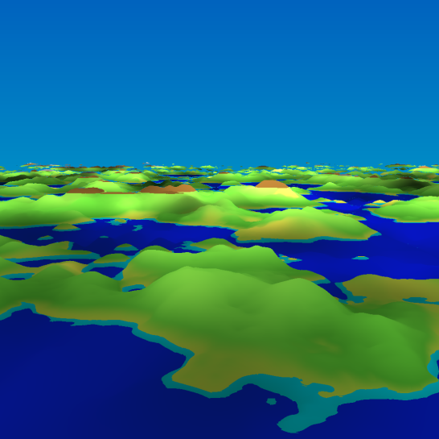
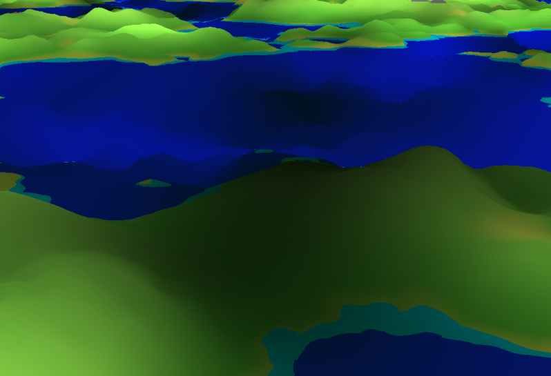
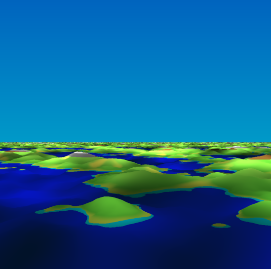
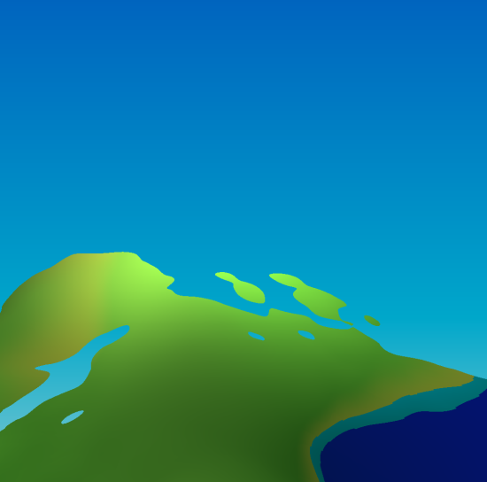
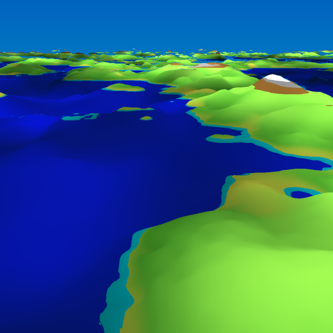
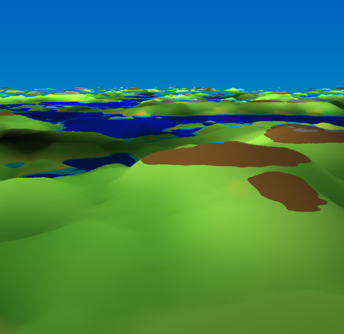
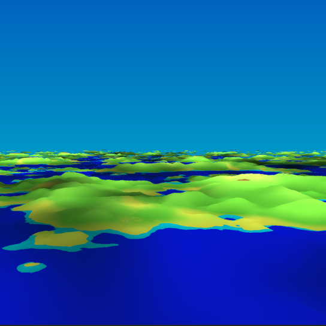
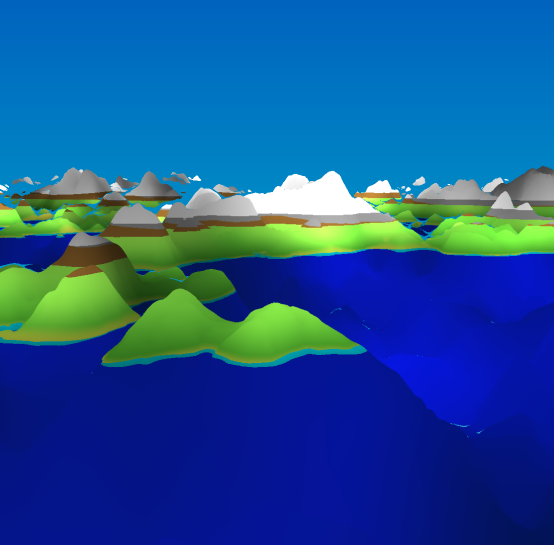

By Zachary Wayne

CSCI 4110 - Advanced Computer Graphics

`Zachary Wayne | CC BY-NC-SA 4.0 (https://creativecommons.org/licenses/by-nc-sa/4.0/)`
# Quick Note
Because OpenGL uses the American spelling of 'colour', color will be used instead.

This projects should contain 11 files:
- 8 Images of the fragment shader running
- The .frag shader file (`terrain.frag`)
- The Markdown version of this document
- The PDF version of this document
Make sure that all of these files are present.

The fragment shader was built using https://thebookofshaders.com/edit.php. It was very helpful in finetuning variables and values with the live editor in this site. You can run this shader program by copying and pasting all the contents of `terrain.frag` into the editor, delete anything that is in there first.
# Overview

This code generates infinite and realistic terrain, although it can only generate terrain on points that won't cause floating point errors. The detail of the terrain is also dependant on the noise function used to create it, but is mathematically infinite just like the size of the terrain.

This fragment shader is a Terrain Generator where you can use the mouse's position to control the orientation of the camera.

The Shader can be split into 3 parts:
- Noise Generation
- Terrain Features
- Ray Marching and Cameras

**Techniques Used**
- Ray Marching
- Smooth Noise
- Bilinear Interpolation
- Fractal Noise
- Rotation Matrices

**Special Features**
- Animated Water
- Animated Cloud Shadows
- Infinite Terrain Generation
## Noise Generation

### Basic Noise
The logic behind this simple noise function is to use the seemingly chaotic nature of high frequency sine waves. This noise function can be swapped with other noise functions, such as Perlin noise or Simplex noise, to decrease the amount of visible artifacts. 

```c
float noise(vec2 p) {
    return fract(sin(dot(p.xy, vec2(12.9898, 78.233))) * 43758.5453 * seed);
}
``` 

After the target point is turned into a float from the dot function, it is passed through the `sin()` and multiplied by a huge randomly picked float and the seed variable.

### Smooth Noise
Because the values that come out of the basic noise function are quite abrupt and discontinuous, a smooth noise function is needed to create more gradual transitions between values. This makes the terrain look more natural and less jagged.

```c
float smoothNoise(vec2 p) {
    vec2 i = floor(p);
    vec2 f = fract(p);

    float a = noise(i);
    float b = noise(i + vec2(1.0, 0.0));
    float c = noise(i + vec2(0.0, 1.0));
    float d = noise(i + vec2(1.0, 1.0));

    float u = f.x * f.x * (3.0 - 2.0 * f.x);
    float v = f.y * f.y * (3.0 - 2.0 * f.y);
    return mix(mix(a, b, u), mix(c, d, u), v);
}
```

This function works by interpolating the values generated by the basic noise function for four adjacent grid points (`a`, `b`, `c`, and `d`). It uses a bilinear interpolation method with `u` and `v` as the weights, calculated based on the fractional part of the coordinates (`f.x` and `f.y`). This smooths out the transitions between noise values, creating terrain that looks more natural. 

### Fractal Noise
Based on fractal Brownian Noise, fractal noise builds on smooth noise by combining multiple layers of noise at different frequencies and amplitudes to generate complex, detailed patterns.

```c
float fractalNoise(vec2 p, float frequency, float amplitude) {
    return smoothNoise(p * frequency) * amplitude; // Octave = 1
}
```

This function takes in a position `p`, scales it by a given frequency, and multiplies the resulting noise value by an amplitude factor. The use of multiple "octaves" (layers of noise with varying frequency and amplitude) adds finer detail to the terrain, mimicking the way mountains, hills, and valleys are created in nature.

Because this code is executed at run-time, the use of `for` loops with variable octaves is not allowed, so this function is nested as later seen in the code to produce multiple octaves.

## Terrain Features
#### Terrain
The terrain, similar to Earth, contains many different features, including mountains, hills, valleys, plains and lakes. These features can be generated using various combinations of the noise functions listed above. All of these features are created in the `terrain` function.

```c
float terrain(vec3 p) {
    p.xz *= xzScale;
    // Mountains
    float baseTerrain = fractalNoise(p.xz * 0.1, 0.4, 2.0);
    float mountainNoise = smoothNoise(p.xz * -0.022) * 4.0;

    // Hills and valleys
    float hillNoise = fractalNoise(p.xz * 0.25, 0.15, 1.2);
    float valleyNoise = smoothNoise(p.xz * 0.15) * 2.5;

    // Surface roughness
    float detailNoise = smoothNoise(p.xz * 0.75) * smoothNoise(p.xz * 0.5) * 0.6;

    // Final terrain height combining multiple features
    float height = baseTerrain * 0.8 + mountainNoise * 0.5 + hillNoise * 0.4 - valleyNoise * 0.3 + detailNoise * 0.2;
    return height;
}
```
**Base Terrain**
- A rough outline of the landscape using fractal noise.

**Mountains**
- Created by applying a smoother noise function scaled to produce large peaks.

**Hills and Valleys**
- Additional layers of noise with higher frequencies to generate smaller, more frequent elevation changes that valleys and hills often create.

**Surface Roughness**
- Adds finer detail to the terrain, mimicking the small irregularities found in natural landscapes.

The `height` value returned by this function is a combination of these layers, creating a varied and realistic terrain height map that is used later on in the code.

#### Coloring

The shader colors the terrain based on the height values, simulating different types of environments such as water, grass, sand, soil, rock, and snow.

```c
vec3 paint(vec3 cameraPos, float height, vec3 currentPosition, inout float dist) {
    vec2 c = currentPosition.xz;
    vec2 d = vec2(-currentPosition.x, currentPosition.z) + vec2(cameraPos.x * 1.2, cameraPos.z * 0.5);
    vec3 color;

    if (height < 0.) { 
        // Water
        float waveFrequency = 3.0;
        float waveAmplitude = 0.2;
        float wave = fractalNoise(c * waveFrequency, 0.1, 0.1) * waveAmplitude;
        float j = -fractalNoise(c, 0.2, 0.2) + 1.112;
        dist = 0.0;
        height = 0.0;
        vec3 waterColor = vec3(0.019, 0.019, 1.000);
        color = mix(color, waterColor + vec3(wave, wave * 0.5, wave * 0.3), j);
    } else if (height < shallowWaterWaveH * smoothNoise(d)) {
        // Shallow Water / Foam
        color = mix(color, vec3(0.000, 0.794, 0.970), 1.);
    } else if (height < 1.160) {
        // Grass
        float j = smoothNoise(c * 0.5) * height;
        color = mix(vec3(0.6, 0.9, 0.3), vec3(0.086, 0.500, 0.081), smoothstep(1., -1., height - j));

        // Sand / Beach
        color = mix(color, vec3(0.945, 0.901, 0.305), smoothstep(0.116, 0., j));
    } else if (height - smoothNoise(c * 0.052) < 0.836 + smoothNoise(c * 0.148) - 0.5) {
        // Soil
        color = mix(vec3(0.6, 0.9, 0.3), vec3(0.5, 0.35, 0.15), smoothstep(-0.520, 0.444, height));
    } else if (height < 1.616) {
        // Stone
        color = vec3(0.5, 0.5, 0.5);
    } else {
        // Snow
        color = vec3(0.860, 0.860, 0.860);
    }

    // Fake Clouds and sunlight
    color = mix(color, vec3(0.003, 0.003, 0.005), smoothNoise(d * -0.075) - smoothNoise(d * 0.276) * 0.944);
    
    // Shadow-like effect
    return mix(color, vec3(0.001, 0.130, 0.000), smoothstep(-1.0, 1.0, -height));
}
```
**Water and Waves**
- If the height is below zero, the area is considered underwater. A wave effect is applied by using fractal noise to simulate subtle ripples on the water surface. The height and distance is also set to zero, making the water flat.

**Shallow Water / Foam**
- In regions with very low height values (near water), a blending effect creates shallow water or foam, using light blue coloring to suggest the shallows of a beach. Noise is added to the shallow water to imitate the crashing of waves on a shore.

**Grass and Sand**
- The shader applies grass textures at mid-level elevations, and where the height is closer to water, a sand or beach effect is added. Noise is added on top to make the sand and grass appear in patches. Sand is more likely to appear near the lower elevations.

**Soil, Rock and Snow**
- As the elevation increases, the terrain transitions into soil, stone, and eventually snow at the highest elevations. A bit of noise is added to the dirt to make it look more natural.

The `paint` function also contains some extra details to make the terrain more realistic.

**Fake Clouds and Sunlight**
- Simple cloud and sunlight effects are created by blending colors with noise patterns. These patterns move slowly across the terrain.

**Shadow-like Effect**
- Shadows are simulated by darkening the terrain based on its height, making lower terrain darker. This also makes the water appear to have depth, but this can be excused as water does have slight transparency allowing you to see the terrain beneath.
## Ray Marching and Cameras
### Ray Marching
Ray marching is used in this shader to render the terrain by tracing rays from the camera through the scene and determining the distance to the surface of the terrain at each step.

```c
vec3 raymarch(vec3 cameraPos, vec3 direction) {
    float totalDistance = 0.0;
    for (int i = 0; i < raymarchMax; i++) {
        vec3 currentPosition = cameraPos + totalDistance * direction;
        float dist = terrain(currentPosition);
        if (dist < 0.01) {
            float height = currentPosition.y;
            return paint(cameraPos, height, currentPosition, dist);
        }
        totalDistance += dist * yScale;
    }
    // Sky color as fallback
    float sty = gl_FragCoord.y / u_resolution.y;
    return mix(vec3(0.557, 0.804, 0.820), vec3(0.243, 0.720, 0.805), sty * 5.);
}
```

1. A ray is cast from the camera position (`cameraPos`) in the direction of the terrain (`direction`).

2. The loop iterates up to `raymarchMax` steps, each time advancing by a small distance. At each step, the `terrain()` function calculates the distance to the terrain surface at that point.

3. If the distance is smaller than a threshold (indicating that the ray has hit the terrain), the `paint()` function is called to determine the color of that point on the terrain.

4. If no terrain is hit, the sky color is returned as a fallback, with a smooth gradient to simulate the horizon.
### Cameras

These two functions, `rotationMatrixY` and `rotationMatrixX`, are used to rotate the camera view along the Y (yaw) and X (pitch) axes, respectively, to allow the user to look around in the scene.

```c
mat3 rotationMatrixY(float angle) {
    float c = cos(angle);
    float s = sin(angle);
    return mat3(
        c, 0.0, s,
        0.0, 1.0, 0.0,
        -s, 0.0, c
    );
}
```

```c
mat3 rotationMatrixX(float angle) {
    float c = cos(angle);
    float s = sin(angle);
    return mat3(
        1.0, 0.0, 0.0,
        0.0, c, -s,
        0.0, s, c
    );
}
```

And finally there is the main method, where the previous functions come together to create the final product and camera angle calculations are made.

```c
void main() {
    vec2 st = gl_FragCoord.xy / u_resolution.xy;
    st.x *= u_resolution.x / u_resolution.y;

    vec3 cameraPos = vec3(0.0, cameraHeight, 3.0);
    
    float yaw = (u_mouse.x / u_resolution.x - 0.5) * PI * 2.0;
    float pitch = -(u_mouse.y / u_resolution.y - 0.5) * PI * .3;

    cameraPos.x += u_time;
    cameraPos.z -= u_time; 
    
    vec3 rayDir = normalize(vec3(st - 0.5, -1.0));
    rayDir = rotationMatrixY(yaw) * rotationMatrixX(pitch) * rayDir;

    gl_FragColor = vec4(raymarch(cameraPos, rayDir), 1.0);
}
```

This code, from the main function, makes the camera move across the surface of the world at a constant speed, the user can think of themselves as the passenger of a helicopter as they look around at the terrain below.

```c
cameraPos.x += u_time;
cameraPos.z -= u_time; 
```

# Input Variables

Throughout the above code, multiple variables were used. These variables can be modified to alter the output of the scene.

```c
float seed = 3.624;
float cameraHeight = 3.144;
float yScale = 1.;                 
float xzScale = 4.808;
float yPreScale = 0.972;
float yPreOffset = 1.584;
float shallowWaterWaveH = 0.128;
const int raymarchMax = 100;
```

The variable effects, along with suggested bounds, can be found at the top of the `terrain.frag` shader file. Some of the effects of changing these variables are shown below in the Outputs section.
# Outputs

Here are some examples of what this shader can create. Not all variables are changed or examined in these examples.

This is what the shader should look like without any modifications to the variables. Notice how the yellow sand is more likely to appear near the water, but isn't only confined to low heights.



Here is a close-up view of a fake cloud (appearing as black in the middle of the water) passing above, and the glow of sun rays along the very top. 


If we keep all the variables the same, but change the `raymarchMax` up (to 1000), terrain that is very far away can be seen. A snow cap mountain can be seen just to the lower-left of centre.


And on the opposite side, turning the `raymarchMax` down yields the following garbage, granted it does run much faster, but these results do not look good.


Going back to `raymarchMax` of 100, the `xzScale` of the terrain is increased, allowing more features to be generated in a smaller area resulting in smaller land masses. 


And `xzScale` at a lower value, much more spread out terrain, bigger land and water masses.


Using the `yPreOffset`, we can change the amplitude of the terrain. Here is the output when `yPreOffset` is high, resulting in flatter terrain.


And a low `yPreOffset` creates high frequency terrain.

---
If I were to continue to work on this shader, I would add a standalone water shader, raytraced shadows and sun beams, and volumetric clouds to make those fake clouds real.